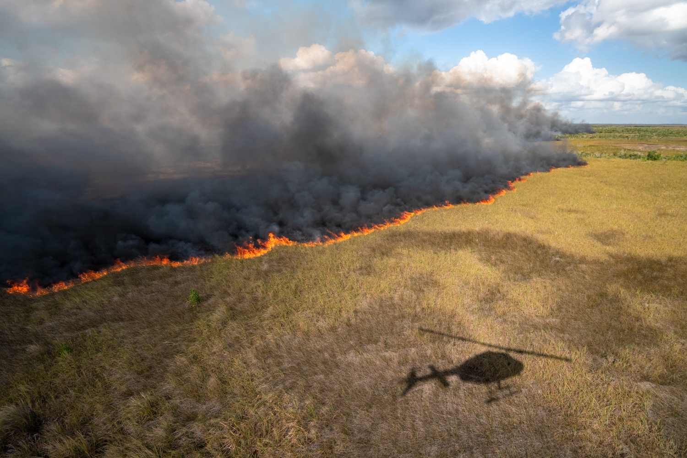

```{r}
#| context: setup
# Load packages
library(shiny)
library(dplyr)
library(leaflet)
library(terra)
library(raster)
library(leafem)
library(htmltools)
library(ggplot2)
library(zoo)
library(readr)
library(plotly)

# Read in reprojected rasters (for later)
total_fires_trim_4326 <- terra::rast(file.path("data", "EVER_BICY_1978_2023_total_fires_trim_4326.tif")) 
time_since_trim_4326 <- terra::rast(file.path("data", "EVER_BICY_1978_2023_time_since_trim_4326.tif")) 

# Read in simplified versions of the rasters (due to large size)
total_fires <- terra::rast(file.path("data", "EVER_BICY_1978_2023_total_fires_trim_simp.tif")) 
time_since <- terra::rast(file.path("data", "EVER_BICY_1978_2023_time_since_trim_simp.tif"))

# Read in vegetation shapefile and its simplified version
veg_orig <- terra::vect(file.path("data", "EVG.L2_4326.shp"))
veg <- terra::vect(file.path("data", "EVG.L2_sim.shp"))

# Read in summary calculations
summary_calculations <- read_csv(file.path("data", "summary_calculations.csv")) %>%
  mutate(roll_mean = zoo::rollmean(total_area_burned, 10, na.pad = TRUE))
```


# About

## Row
In the Florida Everglades, fire is a key driver of ecological dynamics, interacting with hydrology and vegetation structure. Fires have been recorded by Everglades National Park and Big Cypress National Preserve (1978-2023) by mapping the outer boundary of fires. Annual fire perimeter data for the two regions were combined to generate a fire history database for the subtropical landscape. This dataset includes fire perimeters, binary burned layers, and years of fire layers that can be used to quantify fire dynamics across subtropical ecosystems.

Malone, S.L., G. McLeod, A. Chen, and M. Tupaj. 2025. Fire in the Everglades, 1978-2023 ver 1. Environmental Data Initiative. <https://doi.org/10.6073/pasta/72db80a33574c8ad936673d720c9360f>.

<p align="center">

</p>

<center>*Fire in Everglades National Park.*</center>

<center>*Photo: Ian Wilson, NPS.*</center>

# Map 

## {.sidebar}
Current map coordinates (map may take a while to load):

```{r}
# Show current map coordinates
textOutput("current_coords_w")
textOutput("current_coords_e")
textOutput("current_coords_s")
textOutput("current_coords_n")
```

## Row 
```{r}
# Our Leaflet map will show up in the "Map" tab
leafletOutput(outputId = "map")
```

```{r}
#| context: server
# Set the color palettes of the raster layers and shapefile
pal1 <- leaflet::colorNumeric(
  palette = "magma",
  domain = terra::values(total_fires),
  na.color = "transparent",
  reverse = T
)

pal2 <- leaflet::colorNumeric(
  palette = "viridis",
  domain = terra::values(time_since),
  na.color = "transparent"
)

pal3 <- colorFactor(palette = c("#4E79A7FF", "#A0CBE8FF", "#F28E2BFF",
                                "#FFBE7DFF", "#59A14FFF", "#8CD17DFF",
                                "#B6992DFF", "#F1CE63FF","#499894FF"),
                   domain = veg$L2_new)

# Render the foundational Leaflet map
output$map <- leaflet::renderLeaflet({
  leaflet() %>%
  # Add Leaflet-provided gray background map
  leaflet::addProviderTiles(providers$CartoDB.Positron, group = "Gray background") %>%
  # Add Leaflet-provided terrain map
  leaflet::addProviderTiles("Esri.WorldImagery", group = "Imagery") %>%
  # Add vegetation layer
  leaflet::addPolygons(group = "Ecosystem", data = veg, color = ~pal3(L2_new), weight= 0.2,
                fillColor = ~pal3(L2_new), fillOpacity = .7,
                label = ~htmlEscape(paste("Ecosystem:", L2_new))) %>%
  # Add legend for vegetation layer
  leaflet::addLegend(
    group = "Ecosystem",
    data = veg,
    pal = pal3,
    values = veg$L2_new,
    position = "bottomleft",
    title = "Ecosystem"
  ) %>%
  # Add raster layer plot
  leaflet::addRasterImage(group = "Total Fires", total_fires, colors = pal1) %>%
  # Add legend for raster layer
  leaflet::addLegend(
    group = "Total Fires",
    data = total_fires,
    pal = pal1,
    values = terra::values(total_fires),
    position = "bottomleft",
    title = "Total Fires"
  ) %>%
  # Add a second layer
  leaflet::addRasterImage(group = "Years Since Last Fire", time_since, colors = pal2) %>%
  # Add another legend for the second layer
  leaflet::addLegend(
    group = "Years Since Last Fire",
    data = time_since,
    pal = pal2,
    values = terra::values(time_since),
    position = "bottomleft",
    title = "Years Since Last Fire"
  ) %>%
  # Add lat/lon coordinate indicator
  leafem::addMouseCoordinates() %>%
  # Add mouseover popup that shows the value of the raster layers
  leafem::addImageQuery(
    x = raster::raster(total_fires),
    group = "Total Fires",
    position = "bottomright"
  ) %>%
  leafem::addImageQuery(
    x = raster::raster(time_since),
    group = "Years Since Last Fire",
    position = "bottomright"
  ) %>%
  # Set the layer control
  leaflet::addLayersControl(
    baseGroups = c("Gray background", "Imagery"),
    overlayGroups = c("Total Fires", "Years Since Last Fire", "Ecosystem"),
    options = layersControlOptions(collapsed = FALSE)
  ) %>%
  # Hide these groups by default
  hideGroup(c("Years Since Last Fire", "Ecosystem"))
})
 
# Output the current coordinates on the map
output$current_coords_w <- renderText({
  paste0(input$map_bounds$west, "° W")
})

output$current_coords_e <- renderText({
  paste0(input$map_bounds$east, "° E")
})

output$current_coords_s <- renderText({
  paste0(input$map_bounds$south, "° S")
})

output$current_coords_n <- renderText({
  paste0(input$map_bounds$north, "° N")
})
```

# Data

## {.sidebar}

Get summary stats over a spatial area (please be patient): 

```{r}
# Input: Specify the coordinates for the spatial area you want
numericInput(inputId = "west_coord", label = "Degrees West", terra::ext(veg_orig)[1])

numericInput(inputId = "east_coord", label = "Degrees East", terra::ext(veg_orig)[2])

numericInput(inputId = "south_coord", label = "Degrees South", terra::ext(veg_orig)[3])

numericInput(inputId = "north_coord", label = "Degrees North", terra::ext(veg_orig)[4])
```

Download a csv file of the current summary dataframe:

```{r}
# Download button to download a csv of the summary dataframe
downloadButton(outputId = "dl", label = "Data Download")
```

## Row 
```{r}
# Our summary table will show up in the "Data" tab
tableOutput(outputId = "values")
```

```{r}
#| context: server
# Create a SpatVector with our selected bounds
polygon_shape <- reactive({
  e <- terra::ext(input$west_coord,
                  input$east_coord,
                  input$south_coord,
                  input$north_coord)
  p <- terra::as.polygons(e, crs = "epsg:4326")
  return(p)
})

# Find where the two SpatVectors intersect
veg_aoi_vector <- reactive({
  overlap_vector <- terra::intersect(veg_orig, polygon_shape())
  return(overlap_vector)
  })

# Calculate the area of each geometry (ecosystem)
veg_aoi_stats <- reactive({
  area <- terra::expanse(veg_aoi_vector(), unit = "km")
  return(area)
  })

# Calculate the mean number of fires for the specified spatial area
mean_total_fires <- reactive({
  mean_values1 <- terra::extract(total_fires_trim_4326,
                              veg_aoi_vector(),
                              mean,
                              na.rm = TRUE,
                              ID = FALSE) %>%
  dplyr::rename(Mean_num_fires = sum)
  return(mean_values1)
  })

# Calculate the mean number of years since the last fire for the specified spatial area
mean_time_since <- reactive({
  mean_values2 <- terra::extract(time_since_trim_4326,
                              veg_aoi_vector(),
                              mean,
                              na.rm = TRUE,
                              ID = FALSE) %>%
  dplyr::rename(Mean_years_since = max)
  return(mean_values2)
  })

# Assemble the dataframe
table_summary <- reactive({
  data.frame(
    Ecosystem = veg_aoi_vector()$L2_new,
    Area_km2 = veg_aoi_stats(),
    Mean_num_fires = mean_total_fires(),
    Mean_years_since = mean_time_since(),
    West = input$west_coord,
    East = input$east_coord,
    South = input$south_coord,
    North = input$north_coord
  )
})

# Show the values in an HTML table
output$values <- renderTable({
  table_summary()
})

output$dl <- downloadHandler(
  # Create the output file name
  filename = function() {
    paste0(Sys.Date(), "_custom_summary.csv")
  },
  
  content = function(file) {
    # Tell the download button to export the summary dataframe as a csv
    write.csv(table_summary(), file, row.names = FALSE)
  }
)
```

# Area Burned

## Row

```{r}
#| title: "Total Area Burned (m^2) - text formatted"
p <- ggplot2::ggplot(summary_calculations) +
  geom_col(aes(
              x = Year,
              y = total_area_burned,
              text = paste("Area burned:", scales::comma(total_area_burned), "m^2"))) +
  geom_line(aes(x = Year,
                y = roll_mean, 
                group = 1,
                text = paste("Rolling mean:", scales::comma(roll_mean))),
            color = "red") +
  theme_bw() +
  labs(y = "Total area burned (m^2)") 

p %>% plotly::ggplotly(tooltip = c("x", "text"))
```

## Row

```{r}
#| title: "Wildfire Area Burned (m^2)"
plotly::ggplotly(ggplot(summary_calculations, aes(x = Year, y = total_WF_burned)) +
                   geom_col() + theme_bw() +
                   labs(y = "Wildfire area burned (m^2)") +
                   geom_line(aes(y = rollmean(
                     total_WF_burned, 10, na.pad = TRUE),
                     color = "red"))
                 )
```

```{r}
#| title: "Prescribed Area Burned (m^2)"
plotly::ggplotly(ggplot(summary_calculations, aes(x = Year, y = total_RX_burned)) +
                   geom_col() + theme_bw() +
                   labs(y = "Prescribed area burned (m^2)") +
                   geom_line(aes(y = rollmean(
                     total_RX_burned, 10, na.pad = TRUE),
                     color = "red"))
                 )
```

# Mean Stats 

## Row

```{r}
#| title: "Mean Fire Size (m^2)"
plotly::ggplotly(ggplot(summary_calculations, aes(x = Year, y = mean_fire_size)) +
                   geom_col() + theme_bw() +
                   labs(y = "Mean fire size (m^2)") +
                   geom_line(aes(y = rollmean(
                     mean_fire_size, 10, na.pad = TRUE),
                     color = "orange"))
                 )
```

```{r}
#| title: "Mean Fire Area/Perimeter (m)"
plotly::ggplotly(ggplot(summary_calculations, aes(x = Year, y = mean_area_over_perim)) +
                   geom_col() + theme_bw() +
                   labs(y = "Mean fire area/perimeter (m)") +
                   geom_line(aes(y = rollmean(
                     mean_area_over_perim, 10, na.pad = TRUE),
                     color = "orange"))
                 )
```